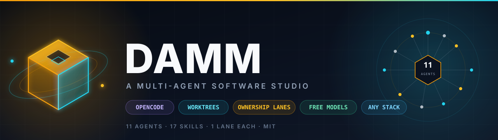
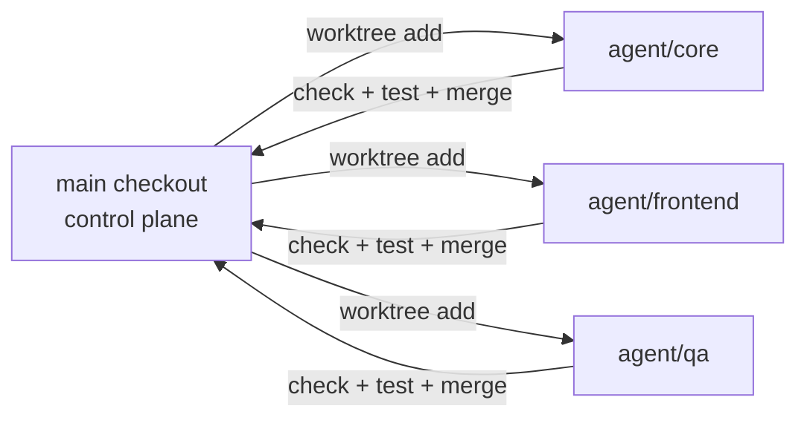

<div align="center">



# DAMM

**A multi-agent software studio for your repository.**

Eleven specialists. One ownership lane each. Real parallel work without overwrites.

[](https://github.com/Abhishek-mee/damm/actions/workflows/validate.yml)
[](LICENSE)
[](docs/SETUP.md)
[](docs/AGENTS.md)
[](docs/AGENTS.md)
[](CONTRIBUTING.md)
[](https://github.com/Abhishek-mee/damm/discussions)

[Quick start](#quick-start) · [Attach your project](#attach-your-project) · [Parallel runs](#parallel-runs) · [How isolation works](#how-isolation-works) · [Agent roster](#agent-roster) · [Docs](docs/SETUP.md)

</div>

---

## The problem

One AI agent in one checkout is a fast typist with amnesia. Give it a team and you get a different problem: two agents edit the same file, one reformat undoes the other's work, and a bad merge erases an afternoon.

DAMM is the missing control plane.

Each agent gets its own **git worktree**, its own **branch**, and a written **ownership lane**. A pre-merge check rejects any edit outside the lane. The director merges one branch at a time, only after the build and tests pass.

```text
human
  └── director ── scope, roadmap, integration
        ├── architect     boundaries, platform, build
        ├── frontend      screens, components, rendering
        ├── core          domain rules, state, persistence
        ├── media         audio, video, images, streaming
        ├── tools         CI, scripts, containers, releases
        ├── designer      spec, flows, usability
        ├── qa            tests, fixtures, release checks
        ├── performance   benchmarks, profiles, budgets
        ├── docs          README, setup, ADRs, changelog
        └── reviewer      read-only review before merge
```

## What this is

DAMM is a **workspace**, not a framework and not a game. It ships:

- **11 agent prompts** tuned for narrow roles
- **17 reusable skills** with concrete rules and a definition of done
- **ownership lanes** in one editable JSON file
- **git worktree tooling** that creates, checks, and merges safely
- **attach mode** for any repository
- **a parallel runner** for 2–4 agents at once
- **free OpenRouter models** by default
- **validation, CI, and a doctor** so the setup stays honest

It works on a web app, a CLI, a library, a data pipeline, or a game. Two worked lane maps ship with the repo: a TypeScript web app in [`examples/web/`](examples/web/) and a C++ game in [`examples/game/`](examples/game/).

## Quick start

**Requirements:** Node.js 20+, git, and [OpenCode](https://opencode.ai). No `npm install` is needed — the workspace has zero runtime dependencies.

```bash
git clone https://github.com/Abhishek-mee/damm.git
cd damm
npm run setup
```

Add a free [OpenRouter key](https://openrouter.ai/keys) to the generated `.env.local`:

```dotenv
OPENROUTER_API_KEY=sk-or-v1-...
```

Then connect the provider once in OpenCode (`/connect` → OpenRouter) and verify every assigned model:

```bash
npm run check-models
```

Create your first isolated worktree:

```bash
npm run worktree -- new core
```

Open the printed folder in OpenCode, select the matching agent, and work there. The main checkout stays clean.

<details>
<summary><strong>What setup prints</strong></summary>

```text
DAMM setup
==========
ok   Node 22.x
ok   git repository
ok   created .env.local from .env.example
ok   OPENROUTER_API_KEY is empty
...
PASS  300+ checks, 1 warning
...
Setup complete. The workspace is ready; attach a project or open a worktree.
```

</details>

## Attach your project

This is the part that makes DAMM yours. Point it at any git repository:

```bash
npm run attach -- ../my-project
npm run worktree -- new core
```

`attach` installs the agent kit into the target, adds it to `.git/info/exclude` so it never enters the target's history, and points every worktree command at that project. Your tracked files are never edited.

```text
../my-project/                  main checkout, untouched
../my-project-worktrees/core/   agent/core
../my-project-worktrees/qa/     agent/qa
```

Need lanes that match your layout? Drop a `damm.config.json` in the project root:

```json
{
  "version": 1,
  "worktreeRoot": "../my-project-worktrees",
  "agents": {
    "director": ["README.md", "docs/roadmap.md"],
    "architect": ["packages/core/**", "build/**", "docs/decisions/**"],
    "frontend": ["apps/web/**", "packages/ui/**"],
    "core": ["packages/domain/**", "packages/api/**"],
    "media": ["packages/media/**", "assets/**"],
    "tools": [".github/**", "scripts/**", "infra/**"],
    "designer": ["docs/design/**", "design/**"],
    "qa": ["tests/e2e/**", "tests/fixtures/**"],
    "reviewer": [],
    "performance": ["benchmarks/**", "profiling/**"],
    "docs": ["docs/**", "README.md"]
  }
}
```

```bash
npm run detach   # go back to working on DAMM itself
```

Full flow, safety properties, and troubleshooting: [`docs/ATTACH.md`](docs/ATTACH.md).

## Parallel runs

Describe the work in a task file, one task per agent:

```json
{
  "concurrency": 2,
  "tasks": [
    {
      "id": "auth-expiry",
      "agent": "core",
      "prompt": "Reject expired tokens at the verification boundary. Add the failing test first.",
      "verify": "npm test -- auth"
    },
    {
      "id": "empty-state",
      "agent": "frontend",
      "prompt": "Add the empty, loading, and error states to the projects screen.",
      "verify": "npm test"
    }
  ]
}
```

```bash
npm run fanout -- --tasks damm.tasks.json          # dry run: plan only
npm run fanout -- --tasks damm.tasks.json --run    # execute
```

The runner creates one worktree per agent, starts one OpenCode session per task, caps concurrency at 4, captures a log per task, runs the ownership check afterwards, and **never merges automatically**. Merge one branch at a time:

```bash
npm run worktree -- merge core
```

Full flow: [`docs/PARALLEL.md`](docs/PARALLEL.md).

## How isolation works



Three layers stop agents from overwriting each other:

| Layer | What it does |
| --- | --- |
| **Worktree** | A full checkout per agent. Uncommitted work is invisible to the others. |
| **Lane** | The agent's `permissions` block allows edits only inside its lane. |
| **Pre-merge check** | `npm run worktree -- check` reads the full diff and fails on any out-of-lane file. |

The merge itself is serialized: dirty base check, project tests, `--no-ff`, no push. A failed check means no merge.

Read the full model in [`docs/WORKTREES.md`](docs/WORKTREES.md).

## Agent roster

| Agent | Mode | Free model | Owns |
| --- | --- | --- | --- |
| `director` | primary | `thinkingmachines/inkling:free` | Scope, roadmap, integration |
| `architect` | subagent | `nvidia/nemotron-3-ultra-550b-a55b:free` | Boundaries, platform, build, ADRs |
| `frontend` | subagent | `cohere/north-mini-code:free` | Screens, components, rendering |
| `core` | subagent | `poolside/laguna-s-2.1:free` | Domain rules, state, persistence |
| `media` | subagent | `google/gemma-4-31b-it:free` | Audio, video, images, streaming |
| `tools` | subagent | `poolside/laguna-xs-2.1:free` | CI, scripts, containers, releases |
| `designer` | subagent | `google/gemma-4-31b-it:free` | Spec, flows, usability |
| `qa` | subagent | `nvidia/nemotron-3.5-lightning:free` | Tests, fixtures, release checks |
| `reviewer` | subagent | `thinkingmachines/inkling-small:free` | Read-only review |
| `performance` | subagent | `nvidia/nemotron-3-super-120b-a12b:free` | Benchmarks, profiles, budgets |
| `docs` | subagent | `dots-studio/dots-3-note-preview:free` | README, setup, ADRs, changelog |

Models are free at the time of writing. `npm run validate` enforces the `openrouter/...:free` shape; `npm run check-models` is the live tool-call test and is the only check that proves a model still works. If one fails, change a single line in its agent file and re-run the check.

<details>
<summary><strong>17 skills included</strong></summary>

`project-orchestration` · `product-spec` · `ux-and-flows` · `system-architecture` · `frontend-engineering` · `core-systems` · `media-pipeline` · `developer-tooling` · `testing` · `tdd-workflow` · `performance-profiling` · `user-testing` · `git-worktree-workflow` · `verification-loop` · `code-review` · `security-review` · `documentation`

Each skill is a `SKILL.md` with concrete rules, commands, and a definition of done. See [`docs/AGENTS.md`](docs/AGENTS.md) for the full matrix.

</details>

## Repository layout

```text
.
├── .opencode/
│   ├── opencode.jsonc        project config, secret policy, defaults
│   ├── agents/               11 agent definitions
│   └── skills/               17 reusable skills
├── docs/
│   ├── SETUP.md              clean-clone setup and troubleshooting
│   ├── ATTACH.md             use DAMM on another repository
│   ├── PARALLEL.md           task files, concurrency, failure handling
│   ├── WORKTREES.md          isolation, commands, recovery
│   ├── AGENTS.md             roster, models, skill matrix
│   ├── FAQ.md                common questions
│   ├── roadmap.md            workspace phases and acceptance
│   └── assets/banner.svg     this README's banner
├── examples/game/            worked example: C++23 + SDL3 + OpenGL
├── examples/web/             worked example: TypeScript + Next.js
├── scripts/
│   ├── setup.mjs             one-command clean-clone setup
│   ├── attach.mjs            install the kit into another project
│   ├── fanout.mjs            parallel runner
│   ├── worktree.mjs          create / check / merge / remove
│   ├── context.mjs           self vs attached mode
│   ├── kit.mjs               local-only kit installer
│   ├── ownership.mjs         lane loading and matching
│   ├── validate.mjs          config, roster, lanes, secrets, scripts
│   ├── doctor.mjs            environment report
│   └── check-models.mjs      free-model tool-call test
├── damm.config.json          lanes and worktree root
├── damm.schema.json          config schema
├── damm.tasks.example.json   fanout task template
├── AGENTS.md                 rules every agent reads first
└── CONTRIBUTING.md
```

## Status

DAMM is honest about where it is.

| Area | State |
| --- | --- |
| Workspace, roster, skills, lanes | **Ready** |
| Worktrees, ownership checks, merge guard | **Ready** |
| Attach mode and kit installer | **Ready** |
| Parallel fanout (dry run) | **Ready** |
| Parallel fanout (live) | **Implemented**, not yet run live in this checkout (needs the `opencode` CLI) |
| Live model check | **Blocked** on an OpenRouter key in this checkout |
| Community gallery of lane maps | Planned |

The roadmap with acceptance criteria is [`docs/roadmap.md`](docs/roadmap.md).

## What this is not

- Not a game engine, and not a game. The game example is optional.
- Not a hosted service. Everything runs on your machine.
- Not a promise that free models are as good as paid ones. The lanes and checks exist because they are not.
- Not a replacement for reading a risky diff yourself.

## Contributing

DAMM is built for collaborators.

- **Pick a lane.** One agent, one change, one pull request.
- **Start small.** A skill, a lane map for your stack, or a bug.
- **Bring evidence.** Commands, output, and a short handoff.
- **Respect the lane check.** If the change crosses lanes, split it.

Read [`CONTRIBUTING.md`](CONTRIBUTING.md) first. Good entry points:

[](https://github.com/Abhishek-mee/damm/issues?q=is%3Aissue+is%3Aopen+label%3A%22good+first+issue%22)
[](https://github.com/Abhishek-mee/damm/issues?q=is%3Aissue+is%3Aopen+label%3A%22help+wanted%22)

Questions and lane maps are welcome in [Discussions](https://github.com/Abhishek-mee/damm/discussions).

## Security

- `.env.local` is gitignored and blocked from agent reads and edits.
- Keys never belong in source, docs, issues, or commit messages.
- `git push`, destructive resets, and cross-directory access require approval.
- The agent kit is local-only in attached projects.
- Report vulnerabilities privately — see [`SECURITY.md`](SECURITY.md).

## License

MIT — see [`LICENSE`](LICENSE). Adapted agent-workflow material is attributed in [`THIRD_PARTY_NOTICES.md`](THIRD_PARTY_NOTICES.md).

## If this saves you a collision

Star the repo. It is the only signal that helps another team find it.

No stars are bought, traded, or faked. DAMM earns attention by being useful, documented, and honest about what works.

<div align="center">
  <sub>Eleven agents. One lane each. No overwrites.</sub>
</div>
